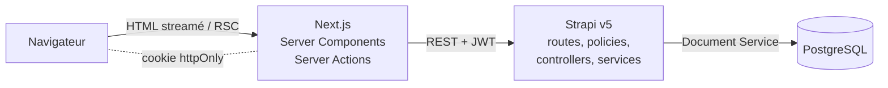

# Communauté Le Revenu

Espace communautaire des lecteurs du Revenu : un **frontend Next.js 16** (App Router, React 19, TypeScript, Tailwind CSS 4) adossé à une **API Strapi v5** (TypeScript, PostgreSQL 16).

Le périmètre couvre l’accueil de la communauté, le détail d’une discussion avec publication de réponses, la création de discussions et la gestion des droits. Côté bonus : recherche, pagination, tests end-to-end Playwright et Docker Compose. L’interface reprend la maquette HTML fournie : charte du Revenu (rouge `#EB0F0F`, Playfair Display), matière « macOS », mode sombre, mobile avec barre de navigation basse.


| Discussion | Mobile |
| --- | --- |
|  |  |

---

## Sommaire

1. [Démarrage rapide (Docker)](#démarrage-rapide-docker)
2. [Développement local](#développement-local)
3. [Comptes de démonstration](#comptes-de-démonstration)
4. [Architecture](#architecture)
5. [Backend Strapi](#backend-strapi)
6. [Frontend Next.js](#frontend-nextjs)
7. [Tests](#tests)
8. [Bibliothèques ajoutées](#bibliothèques-ajoutées)
9. [Limites connues et évolutions](#limites-connues-et-évolutions)

---

## Démarrage rapide (Docker)

Prérequis : Docker (avec Compose v2) et Node.js ≥ 20 (uniquement pour le script d’initialisation).

```bash
node scripts/setup-env.mjs     # crée .env, backend/.env et frontend/.env.local avec des secrets aléatoires
docker compose up --build -d   # PostgreSQL, Strapi et Next.js
```

| Service           | URL                                    |
| ----------------- | -------------------------------------- |
| Communauté        | http://localhost:3000                  |
| API Strapi        | http://localhost:1337/api/discussions  |
| Administration    | http://localhost:1337/admin (compte administrateur à créer au premier accès) |
| PostgreSQL        | `localhost:5433` (utilisateur `strapi`) |

Au premier démarrage, Strapi crée le schéma, applique les permissions et charge la communauté de démonstration (≈ 10 s). Pour repartir d’une base vide : `docker compose down -v`.

## Développement local

Node.js 20 ou 22. PostgreSQL tourne dans Docker, Strapi et Next.js en local avec rechargement à chaud.

```bash
node scripts/setup-env.mjs
docker compose up -d db

cd backend && npm install && npm run develop    # http://localhost:1337
cd frontend && npm install && npm run dev       # http://localhost:3000
```

Scripts utiles :

| Dossier    | Commande             | Rôle                                                       |
| ---------- | -------------------- | ---------------------------------------------------------- |
| `backend`  | `npm run develop`    | Strapi en développement (génère aussi les types TS)        |
| `backend`  | `npm test`           | Tests d’intégration de l’API (base `*_test` dédiée)        |
| `backend`  | `npm run typecheck`  | Vérification TypeScript                                    |
| `frontend` | `npm test`           | Tests unitaires et de composants (Vitest)                  |
| `frontend` | `npm run test:e2e`   | Tests end-to-end Playwright (pile démarrée)                |
| `frontend` | `npm run lint`, `npm run typecheck` | ESLint et TypeScript                        |

## Comptes de démonstration

Les membres de la maquette sont créés par le seed, tous avec le mot de passe `Revenu2026!` (variable `DEMO_USERS_PASSWORD`). La page de connexion les propose en un clic.

| Identifiant   | Profil                                             |
| ------------- | -------------------------------------------------- |
| `Camille_B`   | membre abonnée                                     |
| `Vincent_ETF` | membre très actif                                  |
| `LaRedaction` | compte de la rédaction (étiquette et fond dédiés)  |

---

## Architecture



- **Strapi porte toute la logique métier et la persistance** : validation, rattachement de l’auteur, droits, compteurs. Next.js n’accède jamais à PostgreSQL et ne réimplémente aucune règle : il affiche, met en cache et relaie.
- **Le navigateur ne parle qu’à Next.js.** Les appels à Strapi partent du serveur Next ; le JWT reste dans un cookie `httpOnly` et n’est jamais exposé au JavaScript.

```
backend/
  src/api/category|discussion|reply/   content-types, routes, controllers, services, validation
  src/policies/                         is-authenticated, forbid-author-override
  src/document-middlewares/             maintien de replyCount / lastActivityAt
  src/bootstrap/                        permissions as code, seed de démonstration
  src/extensions/users-permissions/     champs ajoutés au modèle User
  tests/                                tests d’intégration (Vitest + Supertest)
frontend/
  src/app/(community)/                  accueil, espaces, discussion, recherche, charte
  src/app/(focus)/                      publier, connexion
  src/actions/                          Server Actions (auth, publication)
  src/lib/strapi/                       client typé, requêtes en cache, types de l’API
  src/lib/auth/                         session (cookie) et utilisateur courant
  src/components/                       ui, layout, discussion, home, auth
  e2e/                                  scénarios Playwright
```

---

## Backend Strapi

### Modèle de données

| Content Type | Champs principaux | Relations |
| --- | --- | --- |
| **User** (Users & Permissions) | `username`, `email`, + `displayName`, `bio`, `isEditorial`, `isSubscriber` | — |
| **Category** | `name` (unique), `slug` (uid), `description`, `icon`, `color`, `position` | `discussions` (1-n) |
| **Discussion** | `title` (10–160), `slug` (uid), `content` (≤ 10 000), `type` (`question` \| `discussion`), `replyCount`, `lastActivityAt` | `author` → User, `category` → Category, `replies` (1-n) |
| **Reply** | `content` (2–5 000) | `author` → User, `discussion` → Discussion |

Les schémas sont dans `backend/src/api/*/content-types/*/schema.json`. Le brouillon/publication est désactivé : un contenu de membre est public dès sa création. Index ajoutés : `discussions(created_at)`, `discussions(reply_count, last_activity_at)`, `replies(created_at)`.

### API

| Méthode | Route | Accès | Rôle |
| --- | --- | --- | --- |
| `GET` | `/api/categories` | public | Espaces triés, avec nombre de discussions |
| `GET` | `/api/categories/:slug` | public | Un espace |
| `GET` | `/api/discussions` | public | Liste paginée. Paramètres : `category`, `type`, `status=unanswered`, `q`, `sort` (`recent` \| `oldest` \| `active`), `page`, `pageSize` (≤ 50) |
| `GET` | `/api/discussions/:slug` | public | Détail avec réponses |
| `POST` | `/api/discussions` | membre | Création (`{ data: { title, content, type, category } }`) |
| `POST` | `/api/discussions/:slug/replies` | membre | Réponse (`{ data: { content } }`) |

Les erreurs suivent l’enveloppe Strapi (`{ data: null, error: { status, name, message, details } }`) avec des codes cohérents : **400** validation (détail par champ, messages en français), **401** jeton invalide ou expiré, **403** action non autorisée ou usurpation, **404** ressource inconnue.

### Règles métier et sécurité

- **Validation à deux niveaux** : contraintes dans les schémas (longueurs, enum, unicité) et schémas `yup` (natifs Strapi) dans `validation.ts`, qui normalisent les espaces, retirent les champs inconnus et produisent des erreurs par champ. Le titre doit faire 10 caractères **après** normalisation des espaces.
- **Auteur imposé par le serveur** : le contrôleur prend toujours l’auteur dans le JWT vérifié. La policy `forbid-author-override` rejette en **403** toute tentative de publier au nom d’un autre (identifiant numérique, `documentId` ou syntaxe `connect`), au lieu de la corriger silencieusement. Les champs gérés par le serveur (`replyCount`, etc.) envoyés par un client sont ignorés.
- **Permissions as code** (`src/bootstrap/permissions.ts`) : à chaque démarrage, les rôles *Public* et *Authenticated* sont alignés sur une table déclarative pour les API de la communauté. Une permission d’écriture accordée par erreur au rôle *Public* depuis l’admin est retirée au redémarrage. La policy `is-authenticated` constitue un second verrou sur les routes d’écriture.
- **Aucune fuite de données utilisateur** : les relations vers les utilisateurs sont peuplées avec une liste de champs explicite puis passées par des *presenters* (`src/utils/presenters.ts`). L’e-mail ne sort jamais ; `/api/users` reste fermé au public.

### Performance

- **Relations optimisées** : chaque requête précise ses `fields` et son `populate` ; le nombre de discussions par espace passe par `populate: { discussions: { count: true } }`, résolu par Strapi en une requête groupée (pas de N+1).
- **Pagination et tri côté serveur**, avec un critère de départage (`id`) pour une pagination stable ; liste et total sont récupérés en parallèle.
- **Compteur `replyCount` dénormalisé**, maintenu par un *middleware du Document Service* (l’équivalent v5 des lifecycles). Il est **recompté** plutôt qu’incrémenté : il reste juste après une suppression depuis l’admin et se corrige de lui-même si deux réponses arrivent simultanément. Il permet de trier par activité et de filtrer « Sans réponse » sur une colonne indexée, sans `COUNT(*)` par ligne.

### Données de démonstration

`src/bootstrap/seed.ts` charge les contenus de la maquette (18 membres, 11 espaces, 18 discussions et leurs réponses, dates étalées dans le passé) si `SEED_DEMO_DATA=true` et que la base est vide. Le seed s’exécute dans **une transaction** : un démarrage interrompu ne laisse jamais une communauté à moitié remplie. Les deux sondages de la maquette sont écartés, ce type n’étant pas au périmètre.

---

## Frontend Next.js

### Rendu et récupération des données

Le projet utilise le modèle de rendu actuel de Next.js 16 : **Cache Components** et **Partial Prefetching**.

- Chaque page est servie avec une **coquille statique** (en-tête, navigation, squelettes de chargement), puis le contenu dynamique est **streamé** dans des frontières `<Suspense>`. Le *build* l’indique : toutes les routes sont en *Partial Prerender*.
- **Les lectures Strapi sont faites à la requête, mais mises en cache côté serveur** (`src/lib/strapi/queries.ts`) : une fonction exportée attend une vraie requête (`connection()`), puis appelle une fonction `"use cache"` étiquetée (`cacheTag`) avec une durée de vie (`cacheLife`). Le *build* ne dépend donc pas de Strapi : l’image Docker se construit sans backend démarré.
- **Durées de vie** : profil `feed` (30 s) pour les discussions, `reference` (15 min) pour les espaces.
- **Actualisation après écriture** : les Server Actions appellent `updateTag()` sur les étiquettes concernées (`discussions`, `discussion:<slug>`, `categories`). L’auteur voit immédiatement sa publication (*read-your-own-writes*), les autres visiteurs au plus tard à l’expiration du cache.
- **L’état du fil est dans l’URL** (`?vue=unanswered&tri=oldest&page=2`) : partageable, compatible avec le bouton Retour, rendu côté serveur ; les liens fonctionnent sans JavaScript.

### Server et Client Components

Tout est Server Component par défaut : pages, fil, cartes, détail, colonnes latérales. Ne sont clients que les composants qui en ont besoin : les formulaires et leur bouton d’envoi (`useActionState`, `useFormStatus`), le menu du compte, le bouton « Copier le lien », les liens de navigation surlignés (`usePathname`), l’indicateur de chargement des onglets (`useLinkStatus`) et les écrans d’erreur (imposé par `error.tsx`).

### Mutations et authentification

- **Server Actions** (`src/actions`) : validation `zod` pour un retour immédiat, appel de Strapi avec le JWT, conversion des erreurs 400 de Strapi en erreurs par champ, puis `updateTag()` et redirection. Strapi reste la source de vérité : un client qui contournerait le formulaire se heurte aux mêmes règles.
- **Formulaires en amélioration progressive** : publication, réponse et connexion fonctionnent sans JavaScript ; en cas d’erreur, les valeurs saisies sont conservées.
- **Session** : JWT Strapi dans un cookie `httpOnly`, `SameSite=Lax`, `Secure` en production. `getCurrentUser()` (mis en cache par requête avec `React.cache`) interroge `/api/users/me` : un jeton expiré ou révoqué fait simplement redevenir visiteur. Les redirections après connexion n’acceptent que des chemins internes (pas de redirection ouverte).
- **Contenus des membres** : `**gras**`, listes et `@mentions` sont convertis en éléments React, jamais en HTML brut. Pas de `dangerouslySetInnerHTML`, donc pas d’injection de script.

### Interface

- **Design system** : les variables de la maquette (clair et sombre) sont exposées à Tailwind 4 via `@theme` (`bg-surface`, `text-ink-2`, `shadow-card`…). Quelques primitives de marque (`.btn`, `.card`, `.input`) sont dans `globals.css` ; la mise en page reste en classes utilitaires.
- **Responsive** fidèle à la maquette : trois colonnes au-delà de 1184 px, deux en dessous, une seule sous 768 px avec puces d’espaces et barre de navigation basse.
- **Accessibilité** : lien d’évitement, landmarks nommés, `aria-current`, erreurs reliées aux champs (`aria-describedby`, `aria-invalid`), focus visible, `prefers-reduced-motion`.
- **États** : squelettes pendant le chargement, états vides contextualisés (aucune discussion, aucune question sans réponse, recherche sans résultat, page hors limites), pages d’erreur avec « Réessayer », page 404.

---

## Tests

| Suite | Outil | Contenu | Nombre |
| --- | --- | --- | --- |
| API Strapi | Vitest + Supertest, PostgreSQL | refus anonyme (403), jeton invalide (401), validation détaillée, usurpation d’auteur (3 variantes), champs serveur ignorés, slugs uniques, liste/filtre/tri/pagination, absence de données privées, 404, réponses et compteurs | 24 |
| Frontend | Vitest + Testing Library | affichage d’une discussion, rendu sûr du contenu, schémas de validation, état d’URL du fil, redirections sûres, dates relatives | 20 |
| End-to-end | Playwright | parcours visiteur (fil, filtre par espace, tri, détail, accès à la publication) et membre (erreurs, publication, redirection, réponse), sur desktop et mobile | 6 |

```bash
docker compose up -d db
cd backend && npm test            # recrée la base lerevenu_community_test à chaque exécution
cd frontend && npm test
cd frontend && npm run test:e2e   # pile démarrée (Docker ou dev) avec les données de démo
```

Les tests d’API démarrent une vraie instance Strapi sur une base PostgreSQL dédiée (dont le nom doit finir par `_test`, garde-fou contre l’effacement d’une autre base).

## Bibliothèques ajoutées

| Bibliothèque | Pourquoi |
| --- | --- |
| `lucide-react` | Le jeu d’icônes utilisé par la maquette ; import par icône, donc léger |
| `zod` | Validation des formulaires dans les Server Actions, typée et réutilisée dans les tests |
| `server-only` | Empêche d’importer par erreur le client Strapi ou la session dans un Client Component |
| `vitest`, `supertest`, `@testing-library/*`, `jsdom` | Tests d’API et de composants |
| `@playwright/test` | Tests end-to-end |

Côté Strapi, aucune dépendance applicative n’a été ajoutée : validation (`yup`), erreurs, policies et Document Service sont natifs.

## Limites connues et évolutions

- **Code HTTP des pages introuvables** : avec le streaming, une discussion inexistante affiche la page 404 avec une balise `noindex`, mais le statut HTTP reste 200 (la réponse a déjà commencé). Si le statut compte pour le SEO, une vérification en amont dans `proxy.ts` permettrait de renvoyer un vrai 404.
- **Session** : JWT unique de 7 jours. En production, le mode `refresh` de Users & Permissions (jeton court + jeton de rafraîchissement) et une limite de débit sur les routes d’écriture seraient préférables ; la connexion au compte lerevenu.com passerait par un fournisseur SSO.
- **Recherche** : `ILIKE` sur le titre et le contenu, suffisant à cette échelle ; un index plein texte PostgreSQL (`tsvector`, dictionnaire français) prendrait le relais.
- **Réponses** : renvoyées en une fois avec la discussion ; une pagination sera nécessaire pour les fils très longs.
- **Cache** : en mémoire sur chaque instance Next.js ; avec plusieurs instances, un *cache handler* partagé (Redis) éviterait des incohérences temporaires entre instances.
- **Fonctionnalités de la maquette** non couvertes : votes « Utile », meilleure réponse, profils et gamification, sondages, notifications, modération. Le modèle s’y prête : relations `vote`/`solution` sur Reply, policy « auteur de la question » pour choisir la meilleure réponse.
